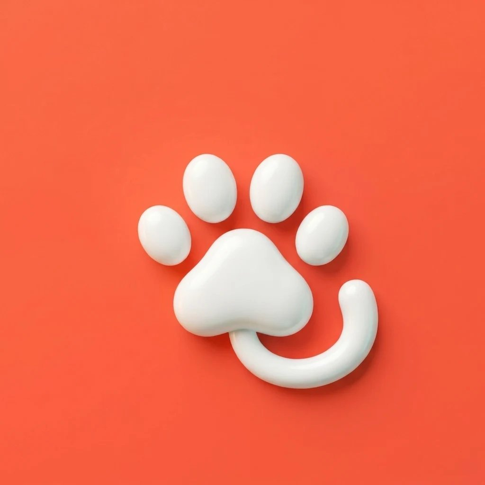
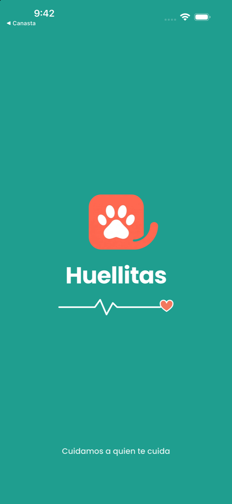
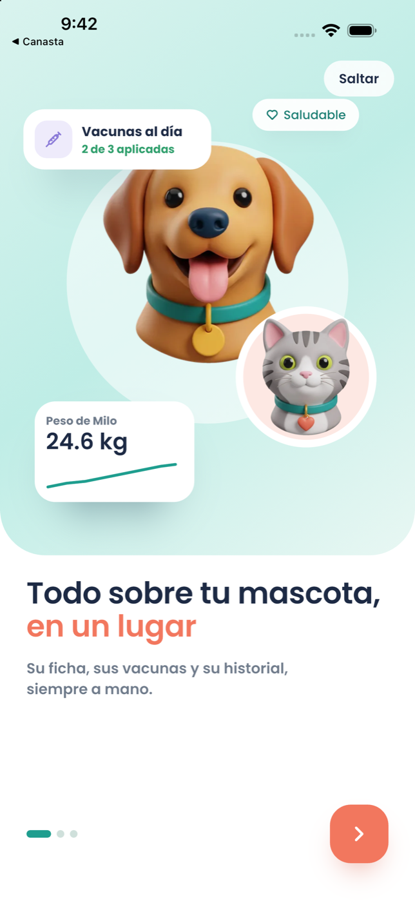
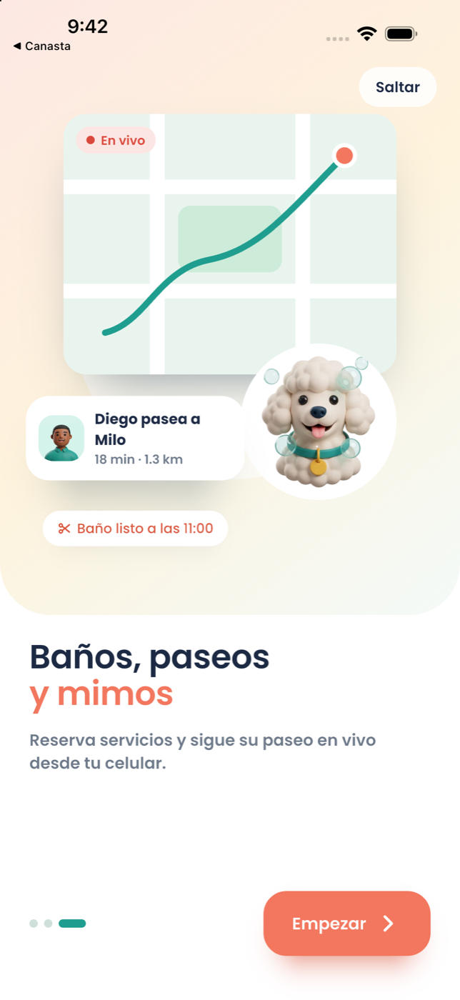
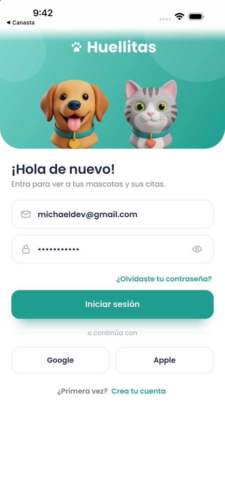
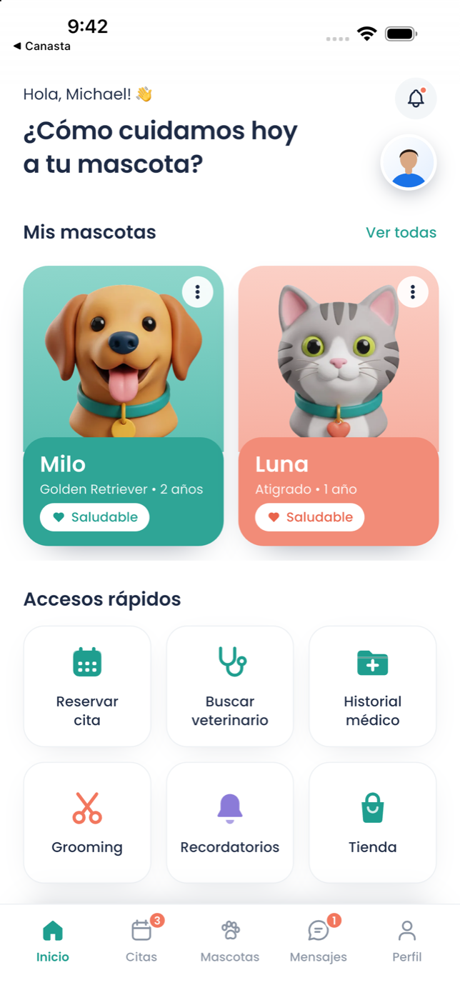
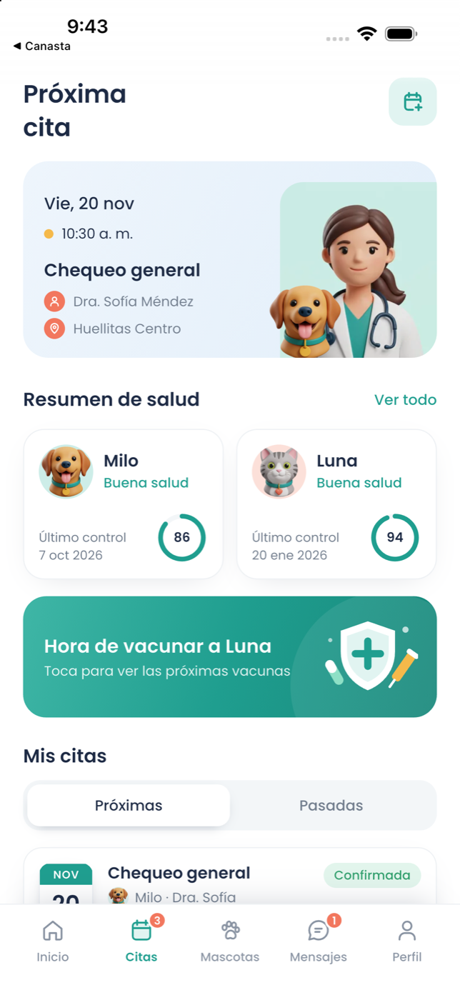
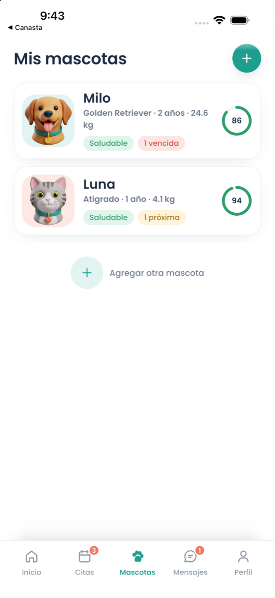
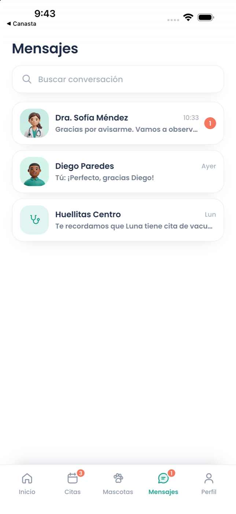
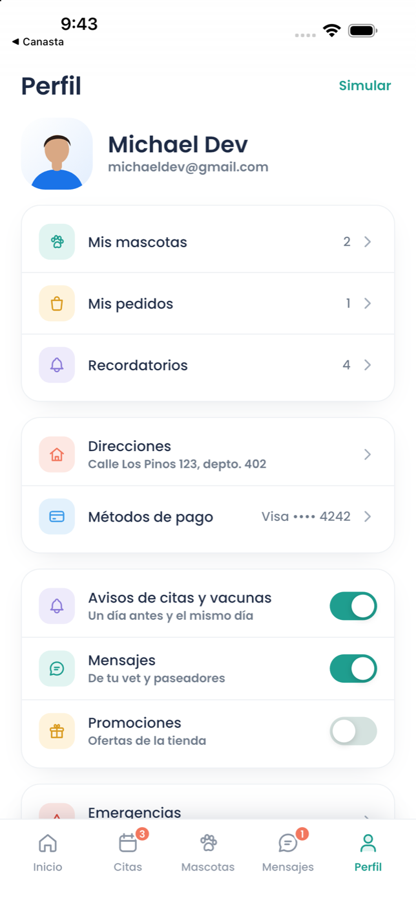

<div align="center">



# Huellitas

**Cuidamos a quien te cuida** — cuidado de mascotas en un solo lugar.


</div>

---

Aplicación en **Flutter + BLoC** para dueños de mascotas, fiel al prototipo `huellitas-prototipo.html` y escrita en español neutro (`es_419`). Reúne la ficha de cada mascota, citas veterinarias, servicios (baños, paseos, grooming), tienda, recordatorios y mensajería.

## Capturas

<table>
  <tr>
    <td align="center"><br/><sub>Splash</sub></td>
    <td align="center"><br/><sub>Onboarding · Mascota</sub></td>
    <td align="center"><br/><sub>Onboarding · Servicios</sub></td>
    <td align="center"><br/><sub>Inicio de sesión</sub></td>
    <td align="center"><br/><sub>Inicio</sub></td>
  </tr>
  <tr>
    <td align="center"><br/><sub>Citas</sub></td>
    <td align="center"><br/><sub>Mascotas</sub></td>
    <td align="center"><br/><sub>Mensajes</sub></td>
    <td align="center"><br/><sub>Perfil</sub></td>
    <td></td>
  </tr>
</table>

## Funcionalidades

- **Mascotas:** ficha, salud (anillo de salud), peso, vacunas y asistente de alta.
- **Citas:** reserva con veterinario, detalle y recordatorios.
- **Veterinarios cercanos:** mapa ilustrado y perfil del vet.
- **Servicios:** baños, grooming, paseos con seguimiento **en vivo**.
- **Tienda:** catálogo, carrito y checkout.
- **Mensajes y notificaciones**, y pantalla de **SOS** de emergencia.

## Arquitectura y stack

| Capa | Tecnología |
| --- | --- |
| UI y tema | `material_ui`, `HuTokens` (`ThemeExtension<HuTokens>`), `HuAccent`, tipografía **Poppins** |
| Estado y persistencia | `flutter_bloc`, `hydrated_bloc`, `equatable` |
| Navegación | `go_router` con `StatefulShellRoute.indexedStack` (Inicio, Citas, Mascotas, Mensajes, Perfil) |
| Inyección | `get_it` (`Clock`, `Toaster`) |
| Gráficos | Ilustraciones y avatares 3D, íconos SVG y `CustomPainter` (`IllustratedMap`, `WeightChart`, `HealthRing`, `PawBurst`) |
| Pruebas | `flutter_test`, `bloc_test`, `mocktail`, `fake_async`, `alchemist` |

### Estructura

```
lib/
├── app/         # DI, router, shell de navegación y raíz de la app
├── core/        # tema, dominio, datos demo, formato y widgets compartidos
└── features/    # auth, onboarding, pets, home, vets, booking, appointments,
                 # services, walk, chat, reminders, notifications, shop, sos, profile
```

## Ejecución

Requiere Flutter con Dart `^3.13.4`.

```bash
flutter pub get
flutter run
flutter test
```

> La app usa datos de demostración locales; no se conecta a ningún backend.

## Autor

**Michael Valdiviezo** — [@VMichael1999](https://github.com/VMichael1999)
